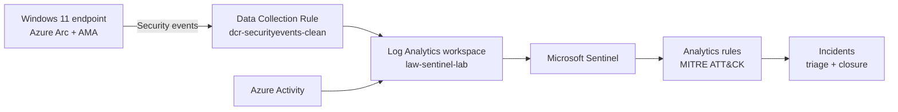
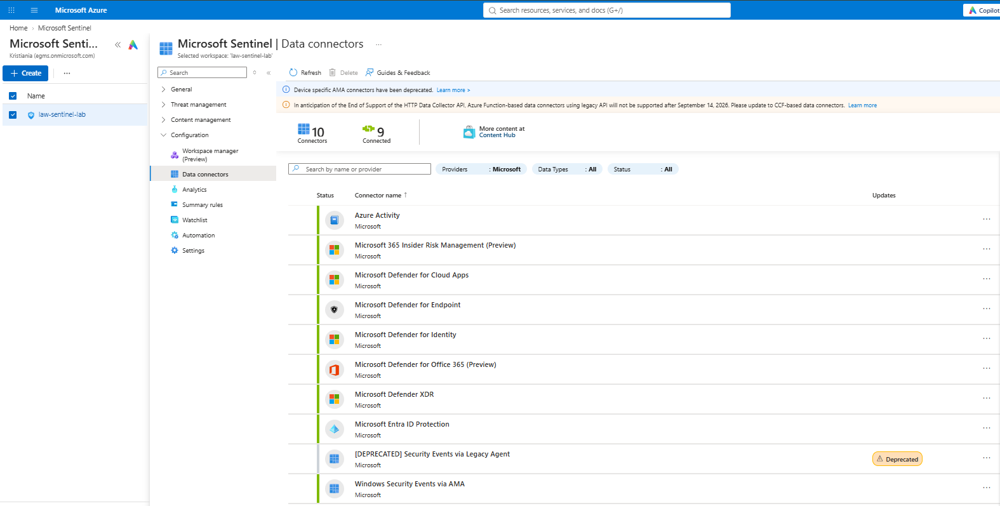
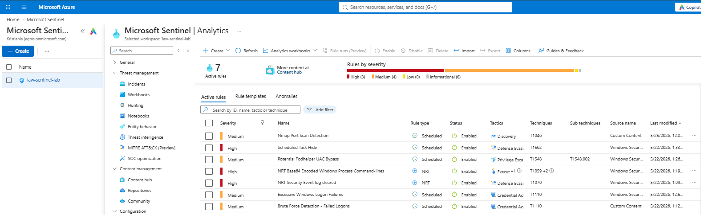
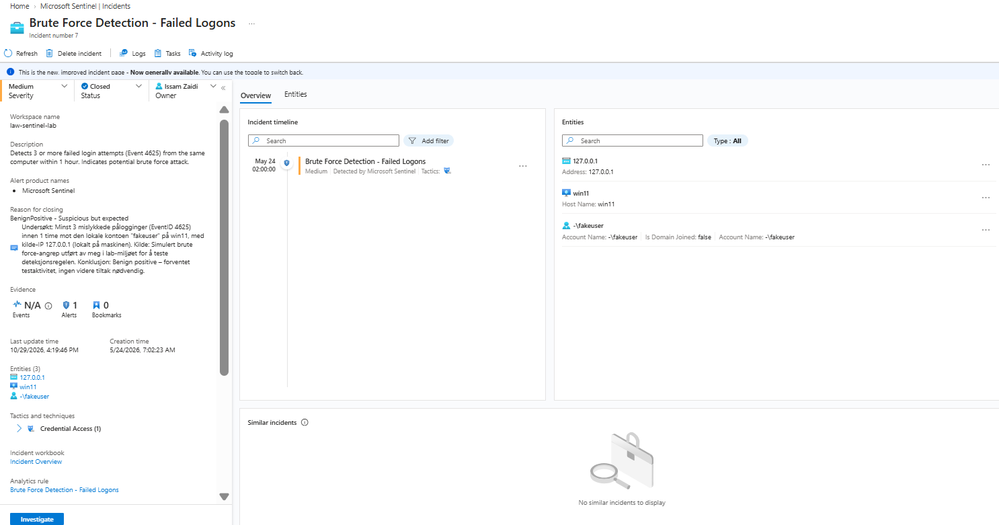

# 08 – Azure Sentinel SOC Lab

A hands-on SOC lab in **Microsoft Sentinel**: a Windows 11 endpoint onboarded with **Azure Arc**, security logs collected with the **Azure Monitor Agent (AMA)**, analytics rules mapped to **MITRE ATT&CK**, and a full incident triage workflow from detection to closure.

## Architecture

| Component | Value |
|-----------|-------|
| Resource group | `rg-sentinel-lab` |
| Region | Sweden Central |
| SIEM | Microsoft Sentinel on Log Analytics workspace `law-sentinel-lab` |
| Endpoint | `win11`, onboarded as an Azure Arc machine |
| Log collection | Azure Monitor Agent + Data Collection Rule `dcr-securityevents-clean` |

## Data Connectors

9 of 10 connectors are connected. The two that feed the lab with data:

- **Windows Security Events via AMA** – security events from the Windows 11 endpoint
- **Azure Activity** – control-plane activity in the Azure subscription

The legacy *Security Events via Legacy Agent* connector is deprecated and is not used; the lab uses AMA instead.

## Detection Rules

7 active analytics rules (3 High, 4 Medium), all mapped to MITRE ATT&CK.

| Rule | Severity | Type | Tactic | Technique | Source |
|------|----------|------|--------|-----------|--------|
| Brute Force Detection - Failed Logons | Medium | Scheduled | Credential Access | T1110 | **Custom** |
| Nmap Port Scan Detection | Medium | Scheduled | Discovery | T1046 | **Custom** |
| Excessive Windows Logon Failures | Medium | Scheduled | Credential Access | T1110 | Template |
| Scheduled Task Hide | High | Scheduled | Defense Evasion | T1562 | Template |
| Potential Fodhelper UAC Bypass | Medium | Scheduled | Privilege Escalation | T1548.002 | Template |
| NRT Base64 Encoded Windows Process Command-lines | High | NRT | Execution | T1059 | Template |
| NRT Security Event log cleared | High | NRT | Defense Evasion | T1070 | Template |

### Custom rule: Brute Force Detection - Failed Logons

- **Logic:** 3 or more failed logons (Event ID 4625) from the same computer within 1 hour
- **Entities mapped:** IP, Host, Account
- **Status:** Validated – detected a simulated brute force attack (see below)

### Custom rule: Nmap Port Scan Detection

- **Logic:** Parses Sysmon network connection events (Event ID 3) from `EventData` and counts distinct destination ports per source IP
- **Schedule:** Runs every 5 minutes with a 5-minute lookback
- **Entities mapped:** IP, Host
- **Status:** Not yet validated against a live scan
- **Known limitation:** Sysmon Event ID 3 only logs completed connections. A default Nmap SYN scan (`-sS`) leaves closed ports unlogged, so the rule should be tested with a connect scan (`nmap -sT`).

## Incident Triage

A brute force attack against a local test account was simulated on the endpoint. The custom rule detected it and created incidents in Sentinel.

**Incident #7 – Brute Force Detection - Failed Logons**

| Entity | Value |
|--------|-------|
| IP | `127.0.0.1` (local) |
| Host | `win11` |
| Account | `fakeuser` (local, not domain joined) |

Triage steps:

1. Assigned the incident to myself and set status to **Active**
2. Investigated the entities (account, host, source IP)
3. Documented the findings in the incident
4. Closed the incident as **Benign Positive – suspicious but expected**, since the activity was an authorized test

## Lessons Learned

- **A detection is only as good as its data source.** Knowing which events land in which table, and what they do not capture, matters as much as the KQL itself.
- **Classification matters.** Authorized test activity is a *Benign Positive*, not a *True Positive*: the rule worked, but there was no real threat.
- **Use current tooling.** The legacy agent is deprecated; AMA with Data Collection Rules gives control over exactly which events are collected.

## Next Steps

- Validate the Nmap rule with a controlled `nmap -sT` scan from a second lab machine
- Test the template rules with Atomic Red Team
- Automate response with a Logic Apps playbook

## Skills

`Microsoft Sentinel` · `KQL` · `SIEM` · `Azure Arc` · `Azure Monitor Agent` · `MITRE ATT&CK` · `Incident Response`
